# GlobalAstro Health — Crew Health System

**Outil d'aide à la décision pour la santé des équipages en mission longue.**
*Decision-support software for astronaut health on long-duration missions.*

NASA Space Apps Challenge 2026 — défi **« Create Health Monitoring Software for Astronauts on Space Missions »** — équipe **K2/\Labs**.

Site en ligne : **https://www.globalastro.health**

---

## Documents

| Document | Contenu |
|---|---|
| [`docs/livrables/Cahier_des_charges_GlobalAstro_Health.pdf`](docs/livrables/Cahier_des_charges_GlobalAstro_Health.pdf) | Périmètre, exigences, architecture, grille de recette |
| [`docs/livrables/Dossier_Projet_GlobalAstro_Health.pdf`](docs/livrables/Dossier_Projet_GlobalAstro_Health.pdf) | Le projet expliqué, avec les captures des deux interfaces |
| [`docs/livrables/Reponses_Composantes_NASA.pdf`](docs/livrables/Reponses_Composantes_NASA.pdf) | Réponses au formulaire de soumission |
| [`docs/livrables/Diaporama_GlobalAstro_Health.pdf`](docs/livrables/Diaporama_GlobalAstro_Health.pdf) | Diaporama de soumission, 7 diapositives |

---

## Langue de l'interface

L'interface se lit en **français ou en anglais**, par un bouton dans le bandeau latéral, sous le
choix du thème. Le français reste la langue de référence : les écrans sont écrits en français, et
l'anglais est posé par-dessus au moment de l'affichage (`src/i18n/`). Une traduction manquante
laisse le texte français — jamais de trou, jamais de clé technique à l'écran.

## Emploi de l'intelligence artificielle

Le règlement du défi demande de déclarer les outils d'intelligence artificielle employés, et
d'indiquer où ils ont servi. Nous l'écrivons ici plutôt que de le laisser deviner.

Un **agent de développement assisté par un grand modèle de langage** a été employé pour écrire et
relire le code des deux interfaces, du module central et de la base du sol, pour rédiger la
documentation du dépôt, pour écrire les scripts de vérification, et pour analyser les mesures afin
de contrôler la cohérence entre les deux postes. Il a été utilisé comme un outil de développement,
sous décision et relecture humaines.

Ce qu'il n'a pas fait : **aucun élément de marque ou de design de la NASA n'a été généré ni utilisé**
(logo, drapeau, identifiant de mission) ; aucune image de synthèse ne figure dans le produit ;
l'identité visuelle a été créée par l'équipe. Les valeurs affichées sont simulées et l'interface
l'indique : aucune donnée médicale réelle n'est traitée, donc aucune donnée personnelle n'a transité
par un outil d'intelligence artificielle.

---

## Le problème

Sur une mission longue, les astronautes subissent cinq dangers documentés par le *Human Research Program* de la NASA : radiation spatiale, isolement et confinement, distance de la Terre, gravité altérée, environnement fermé hostile. Ces dangers entraînent des changements immunitaires, une perte de densité osseuse, des événements cardiovasculaires et des troubles du comportement.

Le point clé de l'énoncé : **« les astronautes portent eux-mêmes une grande partie de la responsabilité de repérer ces changements »**. Il n'y a pas de médecin à bord, et le signal met des dizaines de minutes à atteindre la Terre.

## Deux interfaces, deux métiers

L'application sert deux rôles, et l'interface change entièrement selon celui qui se connecte.

### À bord — l'astronaute

| Module | Rôle |
|---|---|
| **Tableau de bord** (MED-01) | Les indicateurs consolidés, la courbe du paramètre suivi, et les mesures reçues en direct. |
| **Os & Cœur** (PHY-02) | Densité minérale osseuse, score T, système cardiovasculaire, seuil critique tracé. |
| **Santé mentale** (PSY-03) | Sommeil sur 7 nuits, isolement, charge cognitive. |
| **Rayonnement** (RAD-04) | Dose en **% de la limite de carrière** (jamais en mSv absolu : la limite NASA est définie en risque), part des neutrons, simulation d'éruption solaire. |
| **Alerte** (ALT-05) | Détection d'anomalie, actions correctives prioritaires cochables, préparation d'un contact vers le chirurgien de vol. |
| **Hors ligne** (COM-06) | État de la liaison, stockage tampon, file des paquets en attente, synchronisation différée. |
| **Instructions** (MSG-07) | Les consignes préparées au sol, reçues à la fenêtre de communication, avec accusé de réception. |

### Au sol — le médecin

| Écran | Rôle |
|---|---|
| **Équipage** | Les membres suivis avec leurs valeurs reçues à l'instant, leur pire gravité, et la préparation d'une instruction. |
| **Alertes reçues** | Les alertes **dérivées des mesures hors plage** (pas inventées), traitables une par une. |
| **Journal des mesures** | Les dernières mesures de l'équipage, avec leur plage nominale et leur état. |
| **Consignes envoyées** | Le cycle complet : à la prochaine fenêtre → livrée au bord → **lue par l'équipage**. |

Le médecin **ne peut pas agir en direct** : une consigne écrite maintenant part au mieux à la fenêtre suivante, et le signal met 12 minutes pour un aller-retour. C'est ce délai qui structure toute l'interface du sol.

## Captures

Les captures sont dans **[docs/captures](docs/captures)** — régénérées à chaque évolution de l'interface.

| Connexion — le rôle change tout | Tableau de bord · à bord |
|---|---|
| 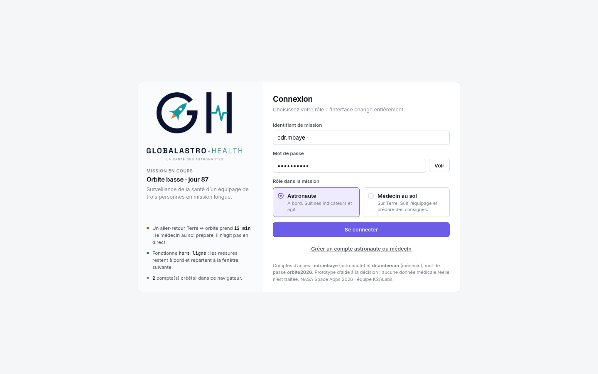 | 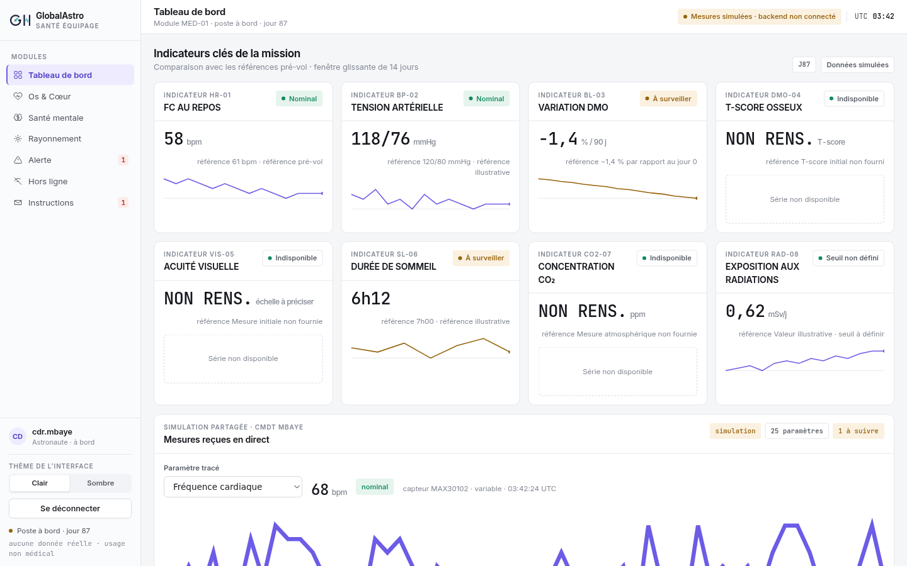 |

**À bord**

| Os & Cœur | Santé mentale | Rayonnement |
|---|---|---|
| 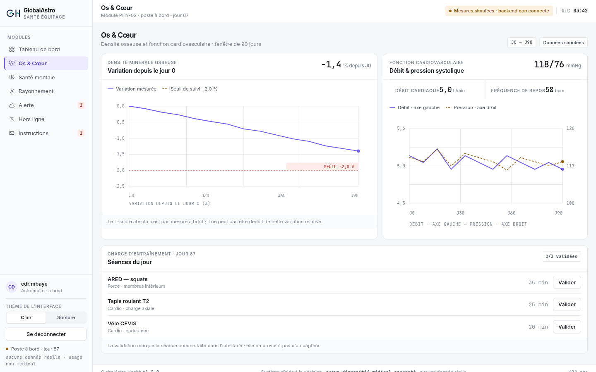 | 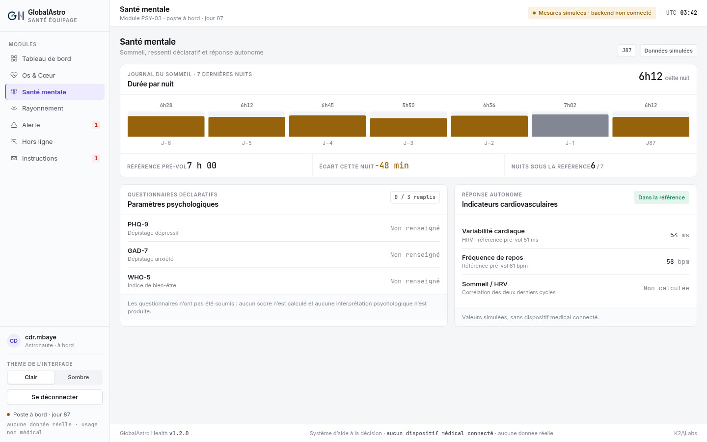 | 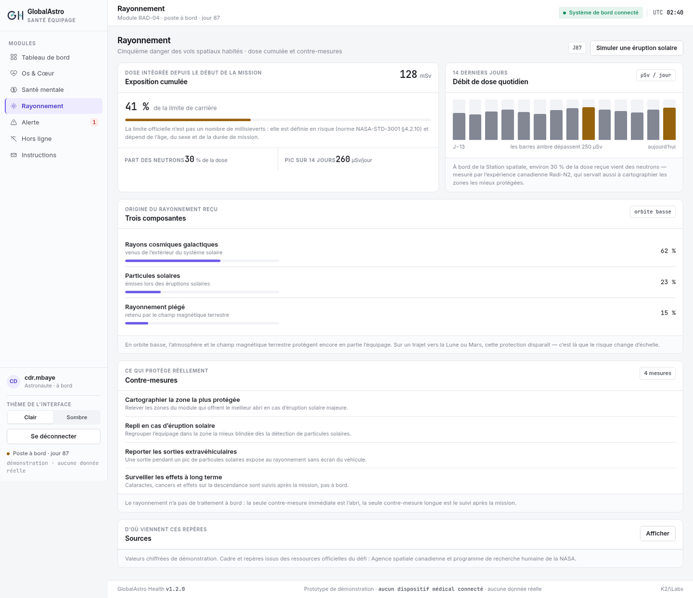 |

| Alerte | Hors ligne | Instructions reçues |
|---|---|---|
| 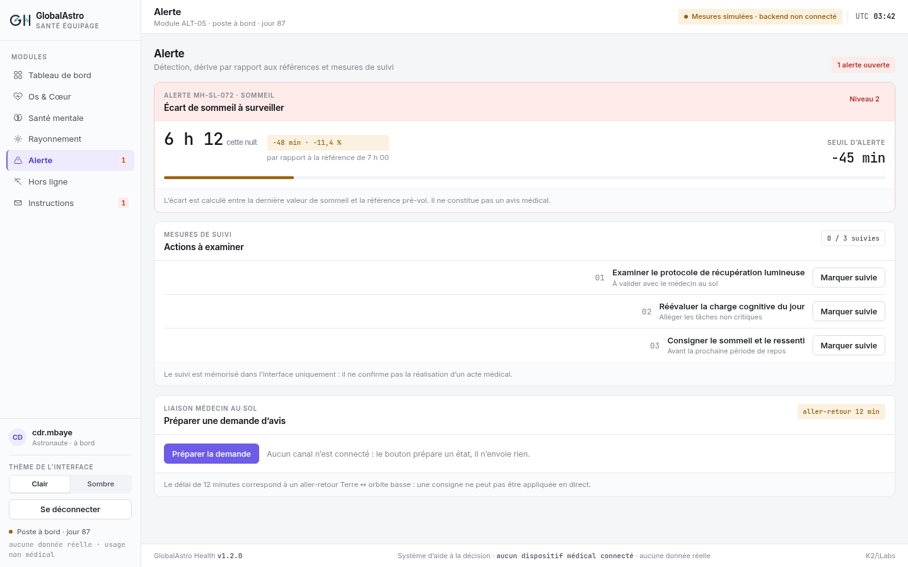 | 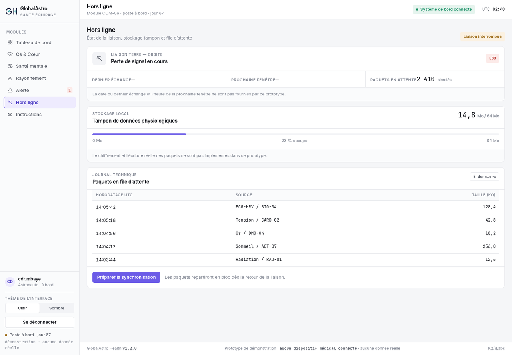 | 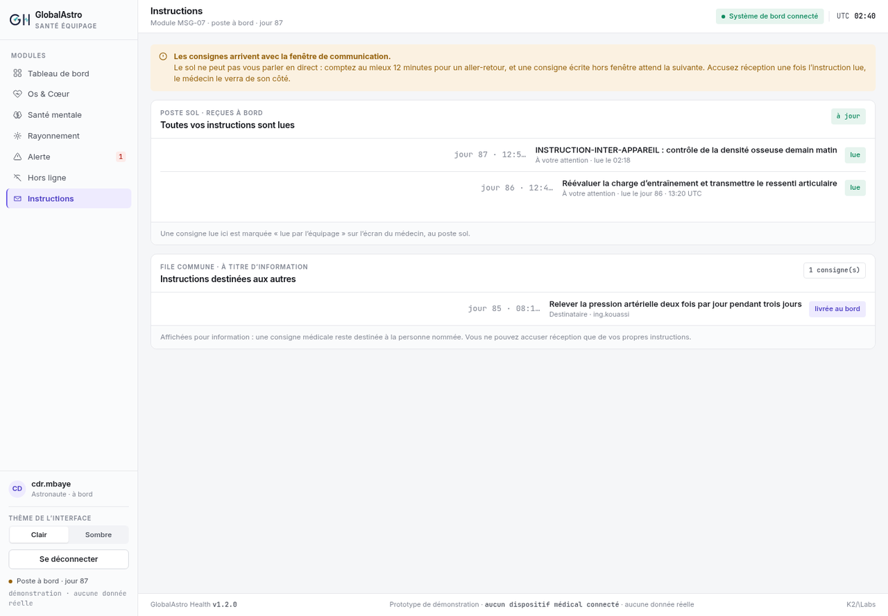 |

**Au sol**

| Équipage | Alertes reçues |
|---|---|
| 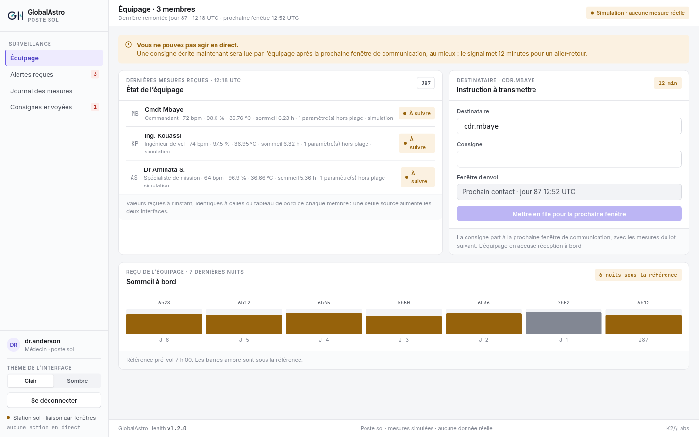 | 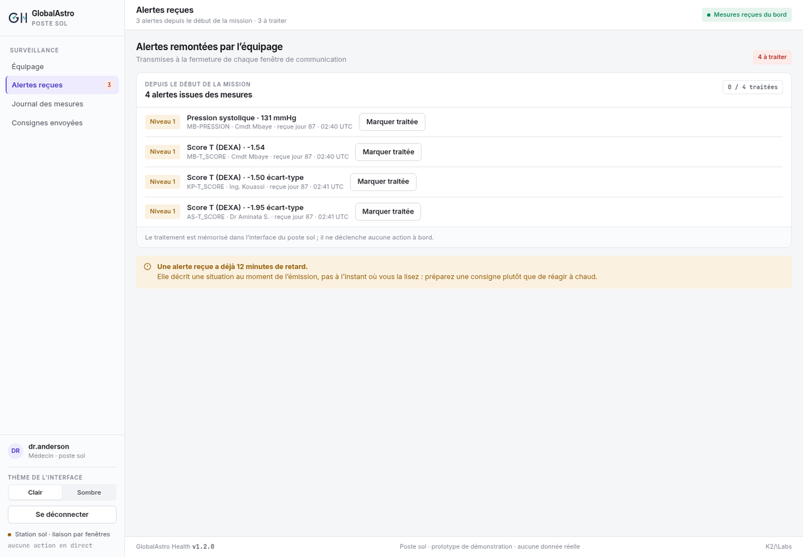 |

| Journal des mesures | Consignes envoyées |
|---|---|
| 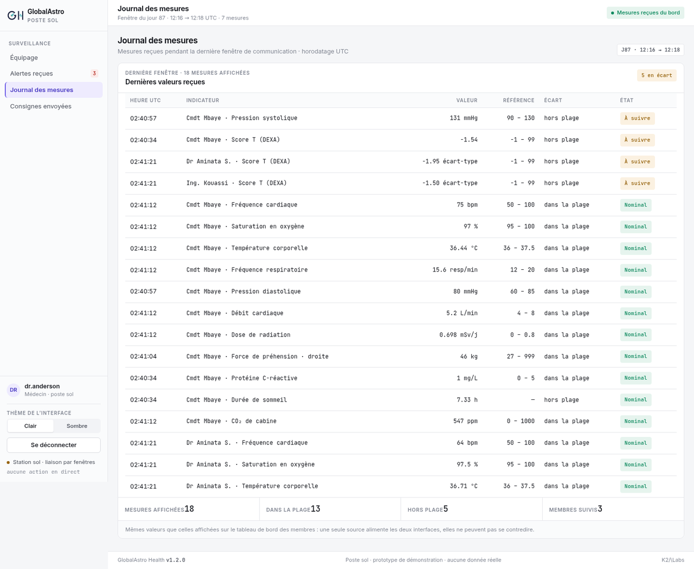 | 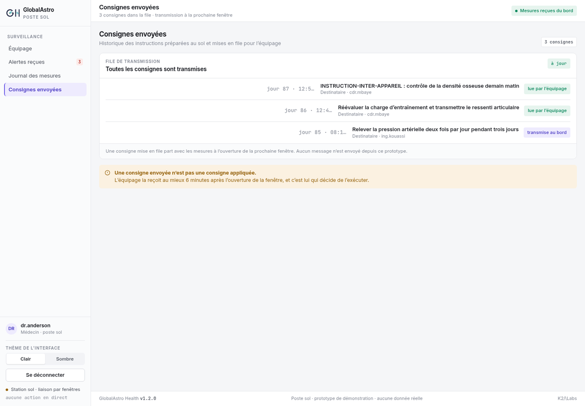 |

## Le principe : décider, pas afficher

Un tableau de bord qui affiche des courbes ne répond pas au défi. La question posée par la NASA est : *« quand un résultat justifie-t-il l'attention de l'équipage ou des chirurgiens de vol au sol ? »*

GlobalAstro Health est construit autour de cette question : chaque indicateur est comparé à une référence et à des seuils, chaque dépassement produit une **action corrective**, et l'escalade vers le sol tient compte du délai réel de communication.

## Architecture

```
        À BORD (aucun réseau requis)                      AU SOL
 ┌────────────────────────────────────┐        ┌────────────────────────────┐
 │  15 capteurs simulés               │        │  Base Supabase (PostgreSQL)│
 │  MAX30102 · MAX30205 · MH-Z19      │        │  comptes                   │
 │  MPU6050 · DEXA · Jamar · Omron    │        │  consignes                 │
 │  GSR · Dosimètre · Bracelet …      │        │  mesures reçues            │
 │              ↓                     │        └────────────────────────────┘
 │  Module central (Python)           │                      ↑
 │  mesures.csv · seuils · statuts    │──────────────────────┘
 │  consignes.csv · astronautes.csv   │   fenêtre de communication
 └────────────────────────────────────┘
        ↑                        ↑
  interface astronaute     interface médecin
```

- **À bord : le module central Python** (`backend/simulation-capteurs/`) reçoit les mesures des capteurs simulés, calcule leur statut selon ses propres seuils et garde tout dans des fichiers locaux. **Rien ne dépend du réseau** — c'est le cœur du sujet.
- **Au sol : Supabase** (PostgreSQL hébergé) garde les comptes, les consignes et les mesures reçues. Le site étant statique, l'API REST de Supabase tient lieu de serveur.
- **Sans base joignable**, une simulation partagée prend le relais dans le navigateur : elle alimente les deux interfaces avec **les mêmes valeurs**, et elle est annoncée comme telle à l'écran.

## Ce qui tourne, ce qui est simulé

Séparation stricte, à ne jamais brouiller devant un jury :

| Élément | État réel |
|---|---|
| Les deux interfaces, la navigation, le build | **Fonctionne** |
| Inscription astronaute / médecin, connexion stricte | **Fonctionne** (base du sol, puis module central, puis stockage local) |
| Consignes du sol vers le bord, accusé de réception | **Fonctionne** (Supabase ou module central ; stockage local en repli) |
| Comparaison aux seuils, alertes dérivées, actions correctives | **Fonctionne** (règles codées, mêmes seuils des deux côtés) |
| Les 15 capteurs simulés et leurs 25 paramètres | **Fonctionnent** (module central, `mesures.csv`) |
| Les valeurs affichées | **Simulées** — aucune donnée médicale réelle n'est publique |
| Transmission Terre–espace réelle, chiffrement des paquets | **Non implémentés** — représentés dans l'interface |

**Choix assumé :** les valeurs physiques sont fabriquées — par les capteurs simulés à bord, par la simulation partagée au sol. L'écran dit toujours d'où vient le chiffre affiché (`capteurs du module` ou `simulation`), et les paramètres non renseignés affichent `NON RENSEIGNÉ` plutôt qu'une valeur inventée.

## Prérequis

- Node.js 22 minimum (compatible Vite 8)
- Python 3.10+ pour le module central (facultatif : le frontend fonctionne seul)

## Installation et lancement

```bash
npm install
npm run dev        # serveur de développement
npm run typecheck  # vérification stricte TypeScript
npm run build      # génération de la version de production (dist/)
npm run check      # typecheck + build
```

**Sous Windows / PowerShell**, `npm` est bloqué par la politique d'exécution des scripts
(`Impossible de charger le fichier npm.ps1…`) :

```powershell
npm.cmd install
npm.cmd run dev
```

ou, une fois pour toutes (sans administrateur) :

```powershell
Set-ExecutionPolicy -ExecutionPolicy RemoteSigned -Scope CurrentUser
```

Le dossier `.figma/` est requis par `vite.config.ts` — **ne pas le supprimer**.

## Lancer la démonstration complète

Pour la démonstration devant le jury, voir **[docs/SCENARIO_DEMO.md](docs/SCENARIO_DEMO.md)** pour le déroulé pas à pas.

```bash
# démonstration locale complète : capteurs + module central + interface
./demo/lancer_demo.sh          # Linux / macOS
demo\lancer_demo.bat           # Windows
```

Le script démarre le module central, lance les capteurs, et affiche l'adresse à ouvrir — ainsi que l'adresse réseau à saisir sur un second appareil si besoin.

## Brancher la base du sol (Supabase)

Facultatif : sans configuration, l'application fonctionne entièrement en local.

1. Créer un projet sur [supabase.com](https://supabase.com) (offre gratuite).
2. **SQL Editor** → coller le contenu de [`supabase/schema.sql`](supabase/schema.sql) → *Run*.
3. **Settings → API** → relever l'**URL du projet** et la clé **`anon` `public`**.
4. Les déclarer dans un fichier `.env` (voir [`.env.example`](.env.example)) ou dans les variables d'environnement de l'hébergeur :

```
VITE_SUPABASE_URL=https://xxxxxxxx.supabase.co
VITE_SUPABASE_ANON_KEY=eyJhbGci…
```

> La clé `anon` est **publique** : elle finit dans le JavaScript du site. La clé `service_role` donne tous les droits — **ne jamais la publier**.

## Organisation du dépôt

- `src/App.tsx` : rôle, navigation, en-tête, écran courant mémorisé.
- `src/views/` : les écrans — à bord (7) et au sol (4).
- `src/components/` : composants partagés (indicateurs, alertes, compte, inscription).
- `src/context/` : session (comptes, thème), backend (sondes), état de démonstration.
- `src/data/` : `missionData.ts` (séries), `simulation.ts` (simulation partagée), `consignes.ts` (file de consignes), `api.ts` (module central), `supabase.ts` (base du sol).
- `supabase/schema.sql` : le schéma de la base du sol.
- `backend/simulation-capteurs/` : le module central Python et les capteurs simulés.
- `demo/` : scripts de lancement de la démonstration.
- `docs/` : scénario de démonstration, sources NASA, captures.

## Sources de données NASA

L'onglet *Resources* officiel du défi ne fournit aucun jeu de données. Les sources ci-dessous sont ouvertes, sans compte :

| Source | Ce qu'elle apporte |
|---|---|
| **OSDR / GeneLab / ALSDA** (`osdr.nasa.gov/osdr/data/search`) | études de biologie spatiale : os, muscle, cœur, immunité, radiations |
| **DONKI** (NASA CCMC) | éruptions solaires, CME, événements de particules — CORS activé |
| **Curiosity RAD** (NASA PDS) | dose de radiation mesurée à la surface de Mars depuis 2012 |
| **NTRS** (`ntrs.nasa.gov/api/citations/search`) | rapports techniques — source des seuils cités |
| **HRP — 5 Hazards / Risks** | cadre des dangers humains en vol spatial |

Détail des liens et des risques cités : **[docs/SOURCES_NASA.md](docs/SOURCES_NASA.md)**.

## Limites connues et périmètre

- Les mesures sont **fictives** et ne doivent servir à aucune décision médicale.
- La base du sol est ouverte en lecture et écriture à la clé publique : c'est un choix de prototype, pas un modèle de sécurité.
- L'empreinte des mots de passe utilise un sel fixe de démonstration.
- Aucun capteur réel, aucun chiffrement de paquets, aucun service NASA n'est connecté.

## Équipe

**K2/\Labs** — NASA Space Apps Challenge 2026.

## Licence

MIT — voir [LICENSE](LICENSE).
