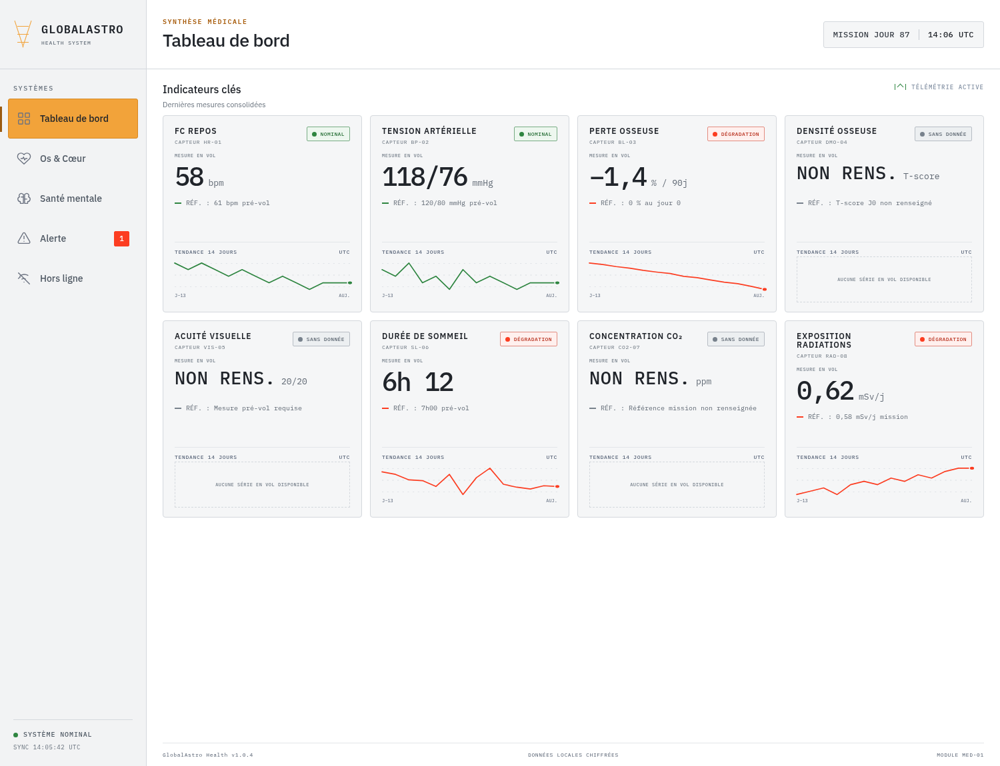
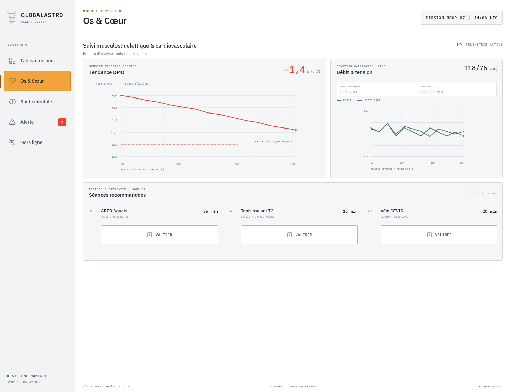
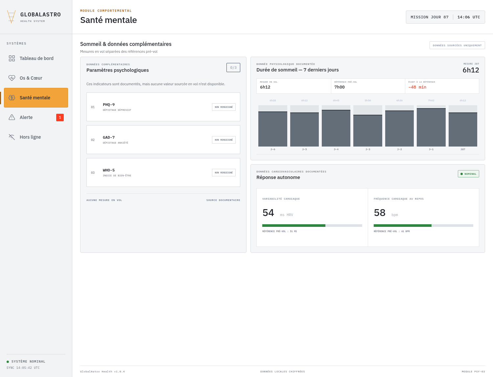
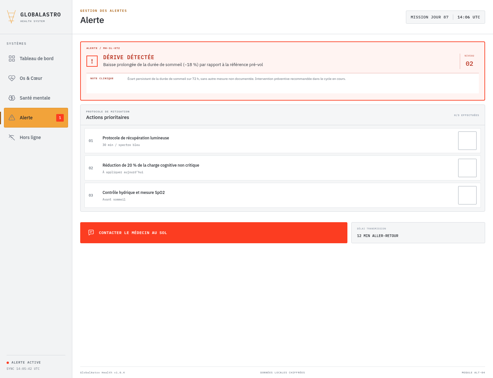
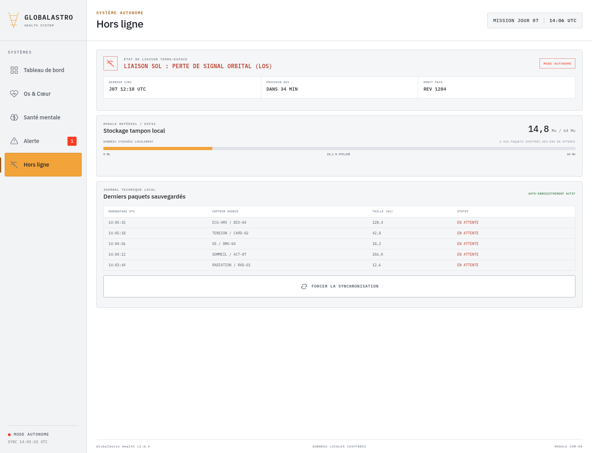

# GlobalAstro Health — Crew Health System

**Outil d'aide à la décision pour la santé des équipages en mission longue.**
*Decision-support software for astronaut health on long-duration missions.*

NASA Space Apps Challenge 2026 — défi **« Create Health Monitoring Software for Astronauts on Space Missions »** — équipe **K2/\Labs**.

---

## Le problème

Sur une mission longue, les astronautes subissent cinq dangers documentés par le *Human Research Program* de la NASA : radiation spatiale, isolement et confinement, distance de la Terre, gravité altérée, environnement fermé hostile. Ces dangers entraînent des changements immunitaires, une perte de densité osseuse, des événements cardiovasculaires et des troubles du comportement.

Le point clé de l'énoncé : **« les astronautes portent eux-mêmes une grande partie de la responsabilité de repérer ces changements »**. Il n'y a pas de médecin à bord, et le signal met des dizaines de minutes à atteindre la Terre.

## Ce que fait GlobalAstro Health

| Module | Rôle |
|---|---|
| **Tableau de bord** (MED-01) | Huit indicateurs consolidés : fréquence cardiaque au repos, tension, perte osseuse, densité minérale, acuité visuelle, sommeil, CO₂, exposition aux radiations — chacun comparé à sa **référence pré-vol** et suivi sur 14 jours. |
| **Os & Cœur** (PHY-02) | Suivi sur 90 jours de la densité minérale osseuse et du système cardiovasculaire, avec **seuil critique tracé** (−2,0 %) et séances d'exercice préventif à valider. |
| **Santé mentale** (PSY-03) | Journal de sommeil sur 7 jours (durée vs référence pré-vol), indicateurs PHQ-9 / GAD-7 / WHO-5, isolement et charge cognitive. |
| **Alerte** (ALT-04) | Détection d'anomalie, **trois actions correctives prioritaires cochables**, et demande de contact vers le chirurgien de vol — avec le **délai de transmission affiché (12 min aller-retour)**. |
| **Hors ligne** (COM-05) | État de la liaison Terre–espace (LOS / AOS), stockage tampon local, journal des paquets en attente, synchronisation différée. |

## Le principe : décider, pas afficher

Un tableau de bord qui affiche des courbes ne répond pas au défi. La question posée par la NASA est : *« quand un résultat justifie-t-il l'attention de l'équipage ou des chirurgiens de vol au sol ? »*

GlobalAstro Health est construit autour de cette question : chaque indicateur est comparé à une référence, chaque dépassement produit une **action corrective**, et l'escalade vers le sol tient compte du délai réel de communication.

## Ce qui tourne, ce qui est simulé

Séparation stricte, à ne jamais brouiller devant un jury :

| Élément | État réel |
|---|---|
| Les 5 écrans, la navigation, le build | **Fonctionne** (captures dans `docs/`) |
| Comparaison aux références pré-vol, seuils, actions correctives | **Fonctionne** (règles codées) |
| Les valeurs affichées | **Simulées** — aucune donnée médicale réelle n'est publique. À générer depuis des plages publiées et sourcées. |
| Appels aux services NASA (OSDR, DONKI, Curiosity RAD) | **Non branchés** |
| Backend | **Non commencé** |
| Chiffrement AES-256, buffer ESP32, store-and-forward | **Représentation d'interface** — non implémentés |

**Choix assumé :** les indicateurs non renseignés affichent `NON RENS.` plutôt qu'une valeur inventée (densité osseuse, acuité visuelle, CO₂). L'outil refuse de fabriquer un chiffre.

## Captures

| Tableau de bord | Os & Cœur |
|---|---|
|  |  |

| Santé mentale | Alerte | Hors ligne |
|---|---|---|
|  |  |  |

## Lancer le projet

```bash
npm install
npm run build     # produit dist/ — le site déployable
npm run dev       # serveur de développement
```

**Sous Windows / PowerShell**, `npm` est bloqué par la politique d'exécution des scripts :

```powershell
npm.cmd install
npm.cmd run dev
```

ou, une fois pour toutes (sans administrateur) :

```powershell
Set-ExecutionPolicy -ExecutionPolicy RemoteSigned -Scope CurrentUser
```

## Sources de données NASA visées

L'onglet *Resources* officiel du défi ne fournit aucun jeu de données. Les sources ci-dessous sont ouvertes, sans compte :

| Source | Ce qu'elle apporte |
|---|---|
| **OSDR / GeneLab / ALSDA** (`osdr.nasa.gov/osdr/data/search`) | études de biologie spatiale : os, muscle, cœur, immunité, radiations |
| **DONKI** (NASA CCMC) | éruptions solaires, CME, événements de particules — CORS activé |
| **Curiosity RAD** (NASA PDS) | dose de radiation mesurée à la surface de Mars depuis 2012 |
| **NTRS** (`ntrs.nasa.gov/api/citations/search`) | rapports techniques — source des seuils cités |
| **HRP — 5 Hazards / Risks** | cadre des dangers humains en vol spatial |

## Origine et outils

Prototype initial généré avec **Figma Make** (React 19, Vite, Tailwind CSS v4), puis repris hors ligne. Le dossier `.figma/` est requis par `vite.config.ts` — ne pas le supprimer.

## Équipe

**K2/\Labs** — NASA Space Apps Challenge 2026.

## Licence

MIT — voir [LICENSE](LICENSE).
